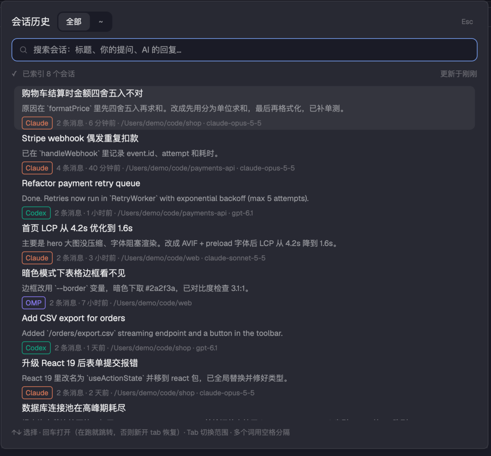

# Session search

A popup that searches the full text of every coding agent session on this machine (Claude Code, Codex, OMP, Pi, Gemini CLI, OpenCode) and opens the one you pick: it focuses the terminal where that session is running, or resumes it in a new tab in the right folder.

## What you see

- A popup 760 px wide at the top of the window (`mod.json` overlay `kind: "popup"`, `at: "top"`, `offset: 40`), on `popover`, 16 px padding, 10 px gaps.
- Header row: "会话历史" (15 px, semibold), a segmented control on `surface` with two pills — "全部" (all) and the focused terminal's folder with `~` for home — the active pill on `selected`, semibold; "Esc" on the right in `dim`, 11 px.
- A 36 px search field: 9 px radius, 1 px `accent` border on `background`, the shipped `mods/workspace-chrome/search.svg` icon at 15 px in `dim`, placeholder "搜索会话：标题、你的提问、AI 的回复…".
- A status line (11.5 px, `dim`): a braille spinner (`frames`, 90 ms, `working` color) while indexing, else ✓; "已索引 N 个会话" on the left and "更新于 3 分钟前" on the right; errors replace it in `blocked`.
- The results list: rows 68 px high with 2 px gaps, list height `min(520, rows × 70)`. Each row: the title (13.5 px semibold, `foreground`, truncated) with a "运行中" badge (`working` background, `background` text, 10.5 px) when live; a preview line (12 px, `muted`) — the matched snippet, or the last message; a meta line (11 px, `dim`): an outlined agent tag (Claude `#d97757`, Codex `#10a37f`, OMP/Pi `#8b7cf6`, Gemini `#5b8def`, OpenCode `#e3814f`), "N 处命中" in `accent` when searching, then "N 条消息 · 3 小时前 · ~/path · model".
- Empty states: "没有匹配的会话", "还没有会话", or "正在建索引，第一次大约需要半分钟…".
- A footer hint (11 px, `dim`): keys and what Enter does.

## How it behaves

- Opens with the most recent 80 sessions, then starts an incremental index run and refreshes when it finishes.
- Typing searches after 120 ms of quiet; stale responses are dropped (sequence number). New results rebuild the list under a new id so it starts at the top.
- `↑` `↓` move the selection (wrapping) and scroll it into view; `Enter` or a click opens; `Tab` toggles the scope; `Esc` closes.
- Open: if a live terminal carries the session (an `agent-resume` label whose `session` matches, or the id in its `argv`) → `pane.focus {terminal}`. Otherwise it checks the folder exists (`exec test -d`), then `tab.new {space, folder, argv, name}` in the local space that has a pane at that folder (else whose `folder` matches), or `space.new {folder, argv, tab}`. A missing folder falls back to home with a warning toast. `argv` is wrapped in `env KEY=VALUE` when the resume needs an environment variable (Codex sessions from Orca's `CODEX_HOME`).
- There are no agent statuses to show; "运行中" is the only live state.

## Built from

- No layout change: `mods/session-search/` with `mod.json` `place: "none"`, opened by `keys.json` `"cmd-shift-h": "mod.open:session-search"`.
- `main.js` (UI), `logic.js` (pure helpers: live-terminal match, launch command, space choice, relative time), `indexer/*.mjs` (Node CLI).
- `herdr` functions: `exec`, `appHome`, `home`, `readTextFile`, `theme`, `props`, `closeOverlay`, `run` (`pane.focus`, `tab.new`, `space.new`), `spaces`, `panes`, `terminals`, `focused`, `notify`. gpui-base: `InputState`, `Input`, `ScrollHandle`, `v_flex`, `h_flex`.
- The mod runs `node indexer/cli.mjs index|search` with `exec` and reads one line of JSON. The node path comes from `config.json` written by the installer.
- Index: `node:sqlite`, tables `sessions`, `files` (path, size, mtime, byte offset), `messages`, and an external-content FTS5 table `messages_fts` with `tokenize='trigram'` kept in sync by triggers.
- Parsers per agent: Claude (`user`/`assistant`/`ai-title`/`custom-title`/`summary` lines, skipping `isMeta`, `isSidechain`, tool results), Codex (`session_meta`, `turn_context`, `response_item` messages; thread names from `session_index.jsonl`), OMP/Pi (`session`, `title`, `message`), Gemini (chat JSON; cwd from sha256 of known folders), OpenCode (SQLite `session`/`message`/`part`, read-only).

## Watch out

- A scroll area inside a popup that sizes to its content must get an explicit height, or it collapses to 0.
- Calling `ScrollHandle.scroll_to_item(0)` right after replacing the rows scrolled a slightly overflowing list to the bottom; giving the list a new id per result set is reliable.
- Herdr's `exec` may not have nvm's `node` on `PATH`; store the absolute path.
- `parseArgs` treats a search starting with `-` as an option: pass `--q=<value>`.
- File mtimes are not trustworthy for "last updated" (tools touch many files at once): use the newest message timestamp.
- Older Claude Code versions wrote sub-agents as `agent-*.jsonl` beside sessions; they contain only sidechain lines and are skipped. Newer ones live under `<session>/subagents/`, which is not walked.
- Codex injects `AGENTS.md` and environment context as user messages; they are filtered out. So are `<system-reminder>`, `<task-notification>` and local-command blocks.
- Gemini resume by id needs a recent Gemini CLI; OpenCode and Gemini resume are best effort.
- Assumes macOS paths for Orca's Codex home; other platforms simply find nothing there.

## Done when

- `herdr-app check ~/.config/herdr-app/mods/session-search` passes.
- `Cmd+Shift+H` shows recent sessions from every installed agent within a second, and "已索引 N 个会话" after the first run.
- Searching a two-character Chinese word and a word that appears only in an AI reply both find their sessions.
- `Enter` on a session running in a Herdr terminal focuses that terminal; on one that is not running, a new tab opens in its folder and the agent shows the old conversation.
- `npm test` passes (indexing, incremental append, pruning, search, launch helpers).
